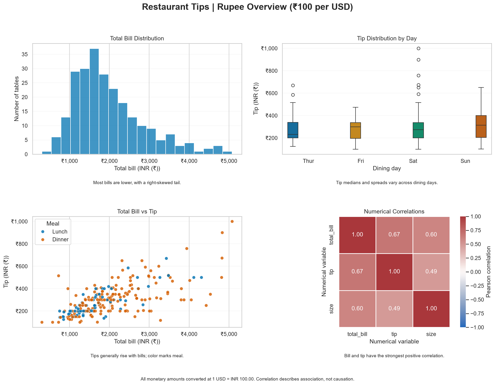

# Data Visualization with Matplotlib & Seaborn

A beginner-friendly data science project that explores the real-world Seaborn Tips dataset. It uses Python, Pandas, NumPy, Matplotlib, and Seaborn to examine customer bills, tips, dining days, and meal periods, then saves five individual charts and a 2×2 overview dashboard.

## Project objectives

- Inspect and clean the dataset, including missing values and exact duplicate rows.
- Explore the distribution of restaurant bills and how tips vary by day.
- Compare total bills and tips, distinguishing Lunch from Dinner.
- Calculate and visualize correlations between numerical fields.
- Produce reusable chart code and a Jupyter notebook suitable for learning and presentation.

## Technologies

- Python 3.10 or later
- Jupyter Notebook
- Pandas, NumPy, Matplotlib, Seaborn

Scikit-learn is not needed for this descriptive visualization project.

## Dataset

The notebook and source code load `sns.load_dataset("tips")`. It contains restaurant bill and tip observations with dining day, meal period, smoking-party status, and party size. The project does not ship a second copy of the dataset; the initial load requires internet access if Seaborn has not cached it. The source values are in US dollars. For presentation, bill and tip amounts are converted to Indian rupees using the user-provided fixed rate **1 USD = INR 100**. This is a chosen visualization rate, not a live or historical exchange rate; the downloaded source data remains unchanged.

## Project structure

```text
Data-Visualization-Matplotlib-Seaborn/
├── notebooks/
│   └── data_visualization.ipynb
├── index.html
├── outputs/
│   ├── histogram.png
│   ├── bar_chart.png
│   ├── box_plot.png
│   ├── scatter_plot.png
│   ├── correlation_heatmap.png
│   └── tips_overview.png
├── src/
│   └── visualization.py
├── README.md
└── requirements.txt
```

## Installation

Open PowerShell in this project folder. Create and activate a virtual environment, then install the dependencies:

```powershell
py -3 -m venv .venv
.\.venv\Scripts\Activate.ps1
python -m pip install --upgrade pip
python -m pip install -r requirements.txt
```

If PowerShell prevents environment activation, either allow it for the current terminal with `Set-ExecutionPolicy -Scope Process -ExecutionPolicy Bypass` or run the environment's Python directly:

```powershell
.\.venv\Scripts\python.exe -m pip install -r requirements.txt
```

## Run the project

From the project folder, generate all six PNG files and print the dataset summary and calculated findings:

```powershell
python src\visualization.py
```

Launch the notebook:

```powershell
jupyter notebook notebooks\data_visualization.ipynb
```

Run the notebook cells from top to bottom. It displays the dataset exploration, rupee-converted amounts, individual visualizations, calculated conclusions, and the dashboard. Each standalone chart and the dashboard is saved under `outputs/` at 150 DPI.

### View the results website

Start a local web server from the project folder:

```powershell
python -m http.server 8000
```

Open [http://localhost:8000](http://localhost:8000) in your browser. The responsive overview page displays the dashboard, individual charts, and findings. Press `Ctrl+C` in PowerShell to stop the server.

## Visualizations

| Output | What it shows |
|---|---|
| `histogram.png` | Distribution and right tail of total bills in INR, with table counts. |
| `bar_chart.png` | Mean tip in INR per dining day, including 95% confidence intervals. |
| `box_plot.png` | Median, spread, and potential outliers in INR tips for each day. |
| `scatter_plot.png` | Relationship between bill and tip in INR; colors distinguish Lunch and Dinner. |
| `correlation_heatmap.png` | Annotated Pearson correlations between total bill, tip, and party size. |
| `tips_overview.png` | A 2×2 dashboard of the bill histogram, tip box plot, bill-tip scatter plot, and correlation heatmap. |

Charts use a color-blind-friendly palette, informative titles, labeled axes, readable INR units, and a short takeaway. The charts note the conversion rate. Correlation describes association, not causation.

## Key findings and conclusions

Calculated from the dataset during project verification (after exact duplicate removal):

- The dataset has 244 rows before cleaning; it contains no missing values and one exact duplicate row, leaving 243 observations.
- At **INR 100 per USD**, the mean total bill is **₹1,981.39**, compared with a median of **₹1,781.00**. Together with the histogram, this indicates a right-skewed bill distribution.
- **Sunday** has the highest average tip (**₹325.51**). Average tips are Thur **₹278.41**, Fri **₹273.47**, Sat **₹299.31**, and Sun **₹325.51**.
- Total bill and tip have a positive Pearson correlation of **0.675**, so larger bills generally accompany larger tips in this sample.
- The strongest correlation among the three numeric variables is between **total_bill** and **tip** (**0.675**); total_bill and size correlate at **0.598**, while tip and size correlate at **0.488**.

These are descriptive results for this dataset, not causal conclusions. The source code and notebook calculate them from the loaded data each time they run.

## Project output previews

Generated chart images are available here after running the project. All monetary values in the chart images are shown in INR using the selected conversion rate. The final dashboard preview is shown below:



- [Total bill distribution](outputs/histogram.png)
- [Average tips by day](outputs/bar_chart.png)
- [Tip distribution by day](outputs/box_plot.png)
- [Total bill vs tip](outputs/scatter_plot.png)
- [Numerical correlation heatmap](outputs/correlation_heatmap.png)
- [Final tips overview dashboard](outputs/tips_overview.png)

## Submission checklist

- [ ] Install requirements in Python 3.10+ and confirm the notebook kernel is selected.
- [ ] Run every notebook cell from top to bottom without errors.
- [ ] Confirm the first five rows, `info()`, `describe()`, missing-value counts, and duplicate handling are shown.
- [ ] Confirm all five individual charts and their takeaways are present.
- [ ] Confirm Lunch and Dinner appear as distinct colors in the scatter plot.
- [ ] Confirm the correlation matrix and annotated heatmap are present.
- [ ] Confirm the final 2×2 dashboard contains all four requested chart types.
- [ ] Confirm all six PNG files exist in `outputs/` and `tips_overview.png` is saved at 150 DPI.
- [ ] Read the values calculated by the run before adding findings to an internship submission.
